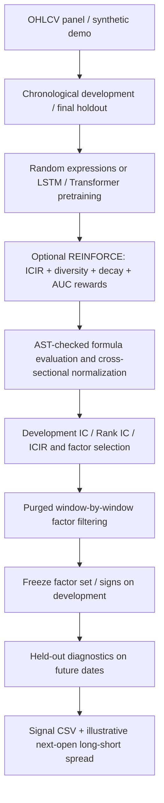

# Auto Alpha Research: Neural Formula Generation & Factor Validation

[](#testing) [](#quick-start)

**Research-grade prototype for automatic formulaic alpha discovery** across A-share-style daily OHLCV panels. The project combines **LSTM / Transformer formula generators**, **REINFORCE policy-gradient search**, **IC / Rank IC / ICIR**, **correlation and diversity constraints**, **rolling factor decay**, a **predictor-network AUC diagnostic**, and **time-ordered validation**.

> **Research transparency:** The original V4–V6 archived metrics were created with an earlier pipeline and are **not** independently verified out-of-sample trading performance. This cleaned release addresses multiple evaluation and security issues; no historical profitability claim is made. Live execution is **disabled by default**. The public repository includes no vendor market data or credentials.

**中文说明：** [README_CN.md](README_CN.md) | [Methodology](docs/METHODOLOGY.md) | [Limitations](docs/LIMITATIONS.md) | [Archived experimental context](docs/ARCHIVED_EXPERIMENTS.md) | [Upload checklist](PUBLICATION_CHECKLIST.md)

## Research pipeline



## What is implemented?

| Component | Implementation |
|---|---|
| Formula generation | Random baseline; LSTM and Transformer token models (PyTorch) |
| Optimization | Supervised formula-language pretraining; optional REINFORCE policy gradients |
| Reward diagnostics | ICIR / Rank ICIR, pairwise correlation, diversity, decay, predictor AUC |
| Time-series validation | Development-only, train-period filtering then chronological test periods; boundary purge |
| Frozen holdout | Last 20% of dates never used for formula/reward training or factor selection in this run |
| Portfolio diagnostic | Cross-sectional high-minus-low return proxy using next-open to subsequent-open outcomes |
| Strategy interface | CSV signals; optional VeighNa monitor-only adapter (not verified for production orders) |

**Validation scope:** Development rolling windows are **not** independent OOS tests of the formula generator, because the candidate generator sees the full development block. Only the final frozen time block is excluded from reward training and factor selection within this new run. If you repeatedly inspect the same holdout, it stops being a fresh blind test.

**Not implemented or not validated:** live execution, a complete A-share transaction-cost / T+1 / shortability simulator, point-in-time universe, corporate-action adjustments, industry/market neutralization, production model registry, or genuine untouched holdout on a dataset repeatedly studied in earlier research.

## Quick start

Python 3.11+ recommended (3.11/3.12); Windows PowerShell or VS Code Terminal:

```powershell
python -m venv .venv
.\.venv\Scripts\Activate.ps1
python -m pip install -r requirements-dev.txt
python run_auto_alpha.py --demo --mode random --quick
python -m pytest -q
```

Use **`--demo` for deterministic, synthetic prices only**. Demo returns and any resulting equity curve are *unit-test artifacts*, not investable market results. Results are written to ignored `artifacts/demo_random/`.

Full-size synthetic random baseline:

```powershell
python run_auto_alpha.py --demo --mode random --experiment demo_random_full
```

Neural generator demonstration (more resource-intensive; generator validity is stochastic):

```powershell
python run_auto_alpha.py --demo --mode lstm --quick
python run_auto_alpha.py --demo --mode transformer --quick
# For full V6 training on your own licensed daily CSV:
python run_auto_alpha.py --data ".\local_data\my_market_data.csv" --mode transformer --experiment v6_transformer
python run_auto_alpha.py --data ".\local_data\my_market_data.csv" --mode lstm --experiment v6_lstm
python run_model_comparison.py
```

**Quick neural mode** trains for one epoch and **disables REINFORCE** for a fast pipeline check. If it produces no valid formulas, it prints `DEMO FALLBACK` and explicitly substitutes random expressions. **This fallback is not neural alpha discovery evidence.** To run policy-gradient training, use a full (non-quick) neural experiment.

### Input schema

Provide one row per `(datetime, symbol)` with **at least**:

```csv
"datetime","symbol","open","high","low","close","volume","amount"
"2024-01-02","000001.SZ",10.00,10.30,9.85,10.12,1000000,10120000
```

`datetime` supports ISO dates and `YYYYMMDD`. Inputs must be chronologically consistent, and rows must not have duplicate symbol/date keys. For private vendor CSV, keep it *outside* the repository or in a separately gitignored local folder. Unit conventions, split histories, corporate-action handling, and universe construction must be validated before treating results as financial evidence.

Optional licensed Tushare downloader (not installed by default):

```powershell
python -m pip install -r requirements-optional.txt
$env:TUSHARE_TOKEN = "<YOUR_NEW_TOKEN>"
python -m data.tushare_loader --symbols 000001.SZ 600519.SH --start 20240101 --end 20241231 --output .\local_data\daily.csv
```

**Never commit your token**. A credential was embedded in the original private archive and must be rotated before publishing or reusing it.

## Outputs

Each run creates `artifacts/<experiment>/` (**excluded by `.gitignore`**) containing:

- `generated_factors.csv`, `factor_matrix.csv`, `factor_scores*.csv`
- `factor_corr_matrix.csv`, `factor_diversity_report.csv`, `factor_decay_report.csv`
- `strict_walk_forward_*` window diagnostics and selection records
- `predictor_report.csv`, `factor_stability_report.csv`, `selected_factors_v6.csv`
- `alpha_signals.csv` (development signals, **no future labels**) and `holdout_alpha_signals.csv`
- `backtest_results.csv` / `equity_curve.csv` (**development diagnostics**) and `holdout_backtest_results.csv` / `holdout_equity_curve.csv` (**frozen holdout diagnostics**)
- optional `rl_training_history.csv` and RL epoch reports (only with policy gradient enabled)

Run report graphics using `python reports/report_builder.py` after collecting experiments. The analysis scripts may require their particular experiment outputs.

## Testing

```powershell
python -m pytest -q
python run_auto_alpha.py --demo --quick --mode random
```

The CI workflow executes the same safe synthetic smoke test. Automated checks are not a substitute for vendor-data reproducibility or realistic historical point-in-time backtests.

## Assumptions / limitations

See [docs/METHODOLOGY.md](docs/METHODOLOGY.md) and [docs/LIMITATIONS.md](docs/LIMITATIONS.md). Signal generation uses today's OHLCV **after the close**. The return proxy assumes entry at the *next session open* and exit at a later open, **not** same-close execution. Equal-weight long-short selection requires shorting that is not generally feasible for arbitrary A-shares; per-period cost is a simplified approximation (not turnover-aware). Distinguish development results, chronological diagnostics and any genuine fresh out-of-sample validation.

## Source organization

```text
run_auto_alpha.py           # CLI entry point: V1–V6 components
run_model_comparison.py     # experiment-level summarizer
generator/                  # random + neural formula language models
rl_trainer/                 # policy-gradient optimization
evaluator/                  # IC, decay and predictor AUC
factor_filter/              # correlation and diversity
operators/                  # safe formula evaluator and time-series operators
backtesting/                # research long-short return proxy
validation/                 # rolling selection and OOS diagnostics
veighna_adapter/            # monitor-only signal bridge
sample_data/                # README only; synthetic demo created at run time
tests/                      # security / leakage / pipeline tests
.github/workflows/ci.yml    # GitHub Actions
```

## Attribution, usage and disclaimer

Public portfolio research; **not financial advice or a trading system**. A public repository does not imply the source is licensed for commercial reuse. Publish only after confirming you have rights to disclose internship-generated code and the archived research methodology. No license is granted unless a license file is deliberately added.
